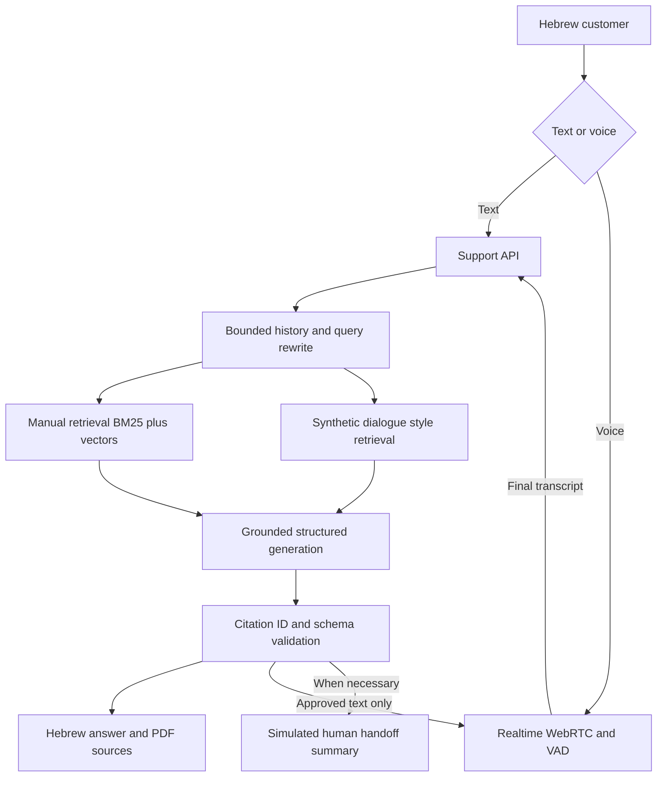

# Colmobil Hebrew vehicle service assistant

A first-line service demo for Hyundai Tucson Hybrid 2025. Customers can type in Hebrew or hold a continuous voice conversation. Technical answers are retrieved from the supplied owner manual, with PDF-page citations. Uncertainty and dangerous symptoms lead to clarification or a simulated human handoff.

## Status

Current continuation evidence is in [docs/LIVE_QA.md](docs/LIVE_QA.md). A dedicated key has been created locally, real embeddings were built for all 646 manual chunks, and provider-backed Hebrew text and Realtime audio checks ran. The source is published to the dedicated GitHub repository and Vercel built an initial protected deployment. The dedicated hosted Secret is connected and the production deployment passed live HTTP and desktop text/source checks. Real browser microphone/listening/interruptions, mobile/noise tests and independent semantic review remain pending; structural passes are not a completed release.

## Development process

[docs/DEVELOPMENT_PROCESS.md](docs/DEVELOPMENT_PROCESS.md) records the confirmed requirements, workflow, architecture decisions, AI-assisted work, validation evidence and remaining tasks.

## Reused foundation

Adapted from [ofek-rag-assignment](https://github.com/IdanHarari11/ofek-rag-assignment): Next.js 16, React 19, TypeScript, Tailwind, OpenAI SDK, local embeddings, BM25 and RRF, bounded conversation history, query rewriting, and Vitest. The new active application is in `src/support/`. Existing `src/rag/` implementation and historical tests remain reusable infrastructure, not evidence that this new domain is validated. Legacy `/api/ask` aliases the new service; legacy title generation is disabled. Attribution for inherited assistant-ui assets: [docs/ATTRIBUTION.md](docs/ATTRIBUTION.md).

## Run

Node >=22, pnpm. Python + PyMuPDF (`pip install pymupdf`) only when rebuilding PDF chunks.

```sh
pnpm install --frozen-lockfile
cp .env.example .env.local
# Configure the NEW OpenAI key locally; never commit it.
pnpm prepare:colmobil  # already committed: 620 PDF pages / 646 chunks
pnpm index:colmobil    # real text-embedding-3-small vectors; requires the new key
pnpm dev
```

```sh
pnpm typecheck
pnpm lint
pnpm test:colmobil
pnpm test:core
pnpm eval:colmobil
pnpm build
```

`pnpm index:colmobil` writes `data/colmobil-index.json`. Commit this non-secret index for Vercel after validation; server functions do not write to their read-only deployed filesystem. Indexing is an offline operation, not run during every deployment. `pnpm eval:colmobil` writes a small retrieval smoke report; it is not answer accuracy or a holdout benchmark.

## Architecture



Detailed decisions, session lifecycle and failure modes: [docs/ARCHITECTURE.md](docs/ARCHITECTURE.md). Evaluation plan and release checks: [docs/EVALUATION.md](docs/EVALUATION.md).

## Deep QA

[docs/QA_PLAN.md](docs/QA_PLAN.md) describes audited defects, regression fixes, 40 exposed development evaluation cases and the live release gates. `pnpm eval:answers:colmobil` makes no model calls unless `--live` is passed.

## Voice choice

OpenAI Realtime handles a continuously open microphone, Hebrew transcription, VAD, audio playback and barge-in over WebRTC. Automatic answer creation is disabled. Each final transcript is sent to the same server RAG as typed text; only the validated answer is sent to an isolated Realtime output response. A sequence counter and abort signals discard stale answers on interruption or disconnect. Keys stay on the server: SDP negotiation is proxied through `/api/voice`.

This trades extra RAG latency for a single auditable answer policy. Reading exact text is still model-mediated, not a guarantee of byte-for-byte audio fidelity. Human listening tests must verify Hebrew pronunciation, numbers, interruption, echo and fidelity. The UI discloses AI-generated voice. No recordings are persisted by this app; audio is transmitted to OpenAI. Vendor retention is governed by the provider account settings, not by this code.

ElevenLabs is a possible alternative output layer after Hebrew listening tests; adding a second provider before the baseline is measured would increase configuration and integration scope. No unsupported claim that one provider has objectively better Hebrew is made.

## Data and safety

- Supplied PDF is authoritative for technical facts. Page references are **1-based PDF pages**, not the printed chapter-page label.
- Eight synthetic conversations are explicitly labeled, retrieved separately for dialogue style, and never accepted as citation sources.
- The supplied sample transcript remains unchanged and is not treated as a mechanically verified procedure.
- Model/year and current driving/parking context are clarified when necessary.
- No diagnosis, mechanical experiments, promised towing, real booking, or real human contact.
- A model-based safety prompt is not a certified safety system. Citation validation verifies IDs, not semantic truth. Do not use this demo for real emergency decisions.
- PDF text extraction has fragmented words and imperfect table reading. Warning symbols/images are not interpreted. Open the original PDF to verify.
- This demo has no durable sessions, authentication, distributed rate limits or CRM integration. Keep Vercel deployment protection enabled while using a paid key. Sessions live in browser memory and reset on refresh. Do not put personal details in test conversations.

## Vercel

Live protected demo: https://colmobil-rag-assignment.vercel.app . Verified application-source candidate: `66588709d1f86c7c24d2ffa4329b7ffab26fa708`; exact tested deployment: https://colmobil-rag-assignment-b82xxzjah-idanharari11s-projects.vercel.app . See LIVE_QA for pending release gates.

Create a separate project connected to this repository. Set `OPENAI_API_KEY` server-side and the optional settings from `.env.example`. Use `pnpm build`, Node 22+, Next.js. `next.config.ts` bundles the manual/chunks/index and synthetic examples with the API functions. Test the **exact deployment commit** and new key before submission. No changes to the original Ofek project or its keys are required.
